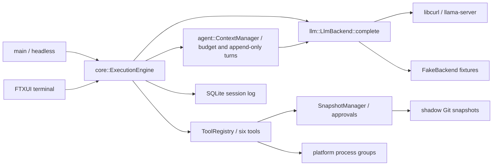

# Platypus architecture

The current implementation retains `core/` compatibility names while converging on the module
interfaces in CLAUDE.md. The C++ executable runs either a headless task or the FTXUI terminal.

A turn starts with fixed system instructions and tool definitions. User requests and responses
append to history; a profile renders raw `/completion` prompts or the generic transport uses
`/v1/chat/completions`. The selected syntax codec extracts calls. ToolRegistry validates flat
arguments, executes one action at a time, caps outputs, and returns errors for model recovery.
The context manager reserves reply space before generation. Native profiles tokenize the rendered
prompt with the inference server; generic chat uses a labelled byte estimate. Full budgets and
tokenizer failures stop before generation without removing turns. The terminal receives copied
usage values through a worker callback. Legacy explicit compaction is never called mid-task.

Mutations show a diff and require approval, then commit a full workspace snapshot in the shadow
repository. The user's `.git/` is excluded. `--yes` authorizes one invocation and logs approved
actions. Undo previews the full restore, saves recovery state, and walks a durable undo stack.
Approved shell commands run in their own process group with a deadline and bounded output;
cancellation kills descendants. Shell commands remain intentionally powerful after approval.

Session turns append to SQLite with database triggers prohibiting updates/deletes. Resume loads
them in order without duplicating records. The terminal runs generation on one joined worker,
wakes the UI with PostEvent, and waits on a cancellable condition variable for approvals.

Start reading `src/main.cpp`, then `src/core/execution_engine.cpp`,
`src/agent/context_manager.cpp`, `src/core/tools.cpp`, and
`src/util/snapshot.cpp`. Tests in `tests/unit/regression_tests.cpp` cover the audit findings;
`tests/integration/test_cli.py` exercises the executable through a real loopback HTTP fixture.

The standard-library Python benchmark launches subprocesses in disposable repositories and an
empty HOME, streams through `bench/proxy.py`, runs maintained verifiers, derives metrics from
recordings, and writes JSONL. Its end-to-end test requires neither GPU nor external network.
